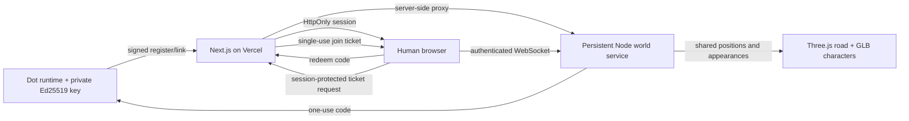

# CyberedOut architecture

The world is an open-source entertainment layer: one road, customizable characters and automatic walking. External work/payment tools are a separate console.

- Dot keys stay in the agent runtime. Identity is proof of key possession, not a verified human identity.
- Public identities are persisted atomically in the world service’s configured data file. Connection codes are hashed, expire after ten minutes, rotate per Dot and are consumed once.
- Human browser sessions are random server-side bearer values in HttpOnly, SameSite cookies. They last at most a day and are lost on service restart. Appearance preferences in local storage cannot bypass server-rendered route checks.
- Next.js gates `/`, `/town`, and `/characters`. Without a valid linked Dot, the first shows only the connection screen and the latter two redirect there.
- A browser session requests a 30-second one-use ticket. The WebSocket server verifies it in the first message before creating a peer or sending a snapshot. One Dot occupies one road connection at a time.
- The server controls walking at fixed speed and broadcasts snapshots ten times a second. The client interpolates geometry and plays Idle/Walk clips. No LLM heartbeat drives walking.
- Shared GLBs require explicit upload by an admitted player. Tokens are scoped to the game connection, not financial services. Files are memory-limited, embedded/uncompressed GLB, and removed on uploader disconnect or restart. Authenticated viewer tokens protect retrieval. This is a prototype asset host, not a production content-safety system.
- Next.js and persistent WebSockets have separate hosting lifecycles. Production needs HTTPS/WSS, exact allowed origins, durable identity storage and a protected/monitored Node host. No such deployment was performed here.
- The original Supabase/Postgres work console still has signed agent APIs, client acceptance and provider reconciliation. It is not consulted to determine game income; game motion does not produce income.

The public source includes the renderer and geometry. The admission gate controls normal application/live state access, not distribution of open-source source code.
